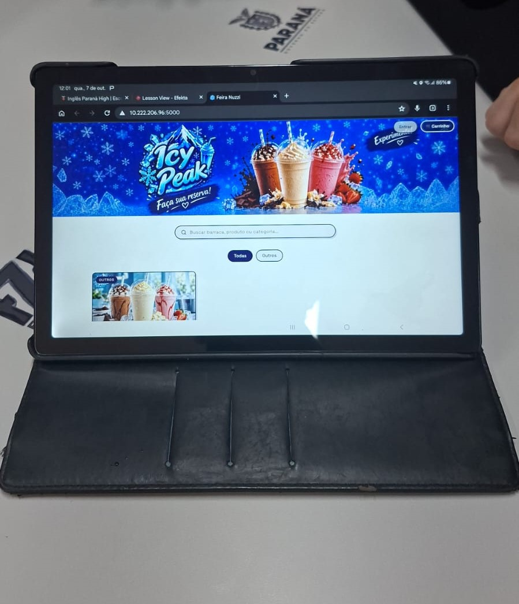

# Sistema de Reservas — Feira Empreendedora

Sistema web desenvolvido para auxiliar na organização das vendas e reservas da Feira Empreendedora.

O projeto foi desenvolvido como uma solução integrada para centralizar produtos, lojas, reservas, pagamentos e funções administrativas em uma única aplicação.

---

## Sobre o projeto

O Sistema de Reservas surgiu a partir da necessidade de organizar o processo de vendas da Feira Empreendedora de forma mais prática e centralizada.

A proposta foi substituir processos manuais por uma aplicação web capaz de reunir as principais informações da feira, permitindo que clientes, lojas e administradores tenham acesso às funções correspondentes às suas responsabilidades.

Durante o desenvolvimento, a equipe trabalhou na integração entre interface, servidor, banco de dados, sistema de reservas, pagamento via PIX e mecanismos de segurança.

---

## Objetivos

O projeto teve como principais objetivos:

- Centralizar os produtos disponíveis na feira.
- Facilitar o processo de reserva para os clientes.
- Auxiliar as lojas no gerenciamento de seus produtos.
- Disponibilizar uma área administrativa.
- Organizar o processo de confirmação das reservas.
- Integrar um sistema de pagamento via PIX.
- Utilizar um banco de dados para armazenar as informações do sistema.
- Aplicar conhecimentos de desenvolvimento web, banco de dados, APIs e segurança.
- Desenvolver uma solução funcional por meio do trabalho colaborativo da equipe.

---

## Estrutura do sistema

O sistema foi dividido em diferentes áreas de acordo com o tipo de usuário.

### Cliente

A área do cliente foi desenvolvida para permitir que os usuários consultem os produtos e realizem suas reservas.

Entre suas principais funções estão:

- Visualização dos produtos.
- Pesquisa de produtos.
- Filtros por categoria.
- Visualização das informações dos produtos.
- Adição de produtos ao carrinho.
- Realização de reservas.
- Consulta do status da reserva.
- Acompanhamento das informações relacionadas ao pagamento.
- Identificação para retirada após a confirmação da reserva.

### Loja

A área da loja permite que os responsáveis pelos estabelecimentos participantes gerenciem seus produtos.

Entre as funcionalidades desenvolvidas estão:

- Cadastro de produtos.
- Alteração de produtos.
- Controle de estoque.
- Visualização das reservas relacionadas aos produtos.
- Organização dos produtos disponíveis.

Os produtos comuns utilizam informações como:

- Nome.
- Descrição.
- Preço.
- Estoque.

A estrutura também foi pensada para permitir produtos que necessitem de opções adicionais, como tamanhos, sabores e adicionais.

### Administração

A área administrativa concentra funções destinadas à organização geral do sistema.

Entre elas estão:

- Gerenciamento das informações do sistema.
- Gerenciamento das lojas.
- Organização dos produtos.
- Acompanhamento das reservas.
- Controle de informações administrativas.
- Supervisão das operações realizadas na plataforma.

O acesso administrativo é separado das funções destinadas aos clientes e às lojas.

---

## Sistema de reservas

O sistema permite que o cliente selecione os produtos disponíveis e realize uma reserva através da plataforma.

Após o envio da reserva, as informações são armazenadas no banco de dados para que possam ser acompanhadas e posteriormente processadas pela equipe responsável.

O fluxo foi estruturado para manter o controle sobre:

- Cliente.
- Produtos.
- Quantidades.
- Estoque.
- Reserva.
- Pagamento.
- Status da reserva.
- Retirada.

Dessa forma, o sistema mantém as informações relacionadas à reserva centralizadas.

---

## Sistema de pagamento via PIX

O projeto possui uma funcionalidade de pagamento via PIX desenvolvida especificamente para o contexto da Feira Empreendedora.

A solução não depende de gateways externos de pagamento.

O fluxo desenvolvido funciona da seguinte forma:

1. O cliente realiza a reserva.
2. O sistema apresenta as informações necessárias para o pagamento.
3. O cliente realiza o pagamento externamente.
4. O cliente informa através do sistema que realizou o pagamento.
5. A reserva passa para o estado de aguardando confirmação.
6. A equipe responsável verifica o pagamento.
7. Após a confirmação, a reserva é liberada para retirada.

Esse modelo permite que o pagamento seja acompanhado pelo sistema sem que seja necessário integrar diretamente uma instituição financeira ou gateway de pagamento.

---

## Arquitetura

O projeto utiliza uma arquitetura baseada na comunicação entre frontend, backend e banco de dados.

```text
                    CLIENTE
                       |
                       v
                  FRONTEND
                       |
                   HTTP / API
                       |
                       v
                    FLASK
                       |
                       v
                 BANCO DE DADOS
                    SQLITE
```

### Frontend

Responsável pela interface utilizada pelos clientes, lojas e administradores.

É a camada responsável pela apresentação das informações e pela interação dos usuários com o sistema.

### Backend

O backend foi desenvolvido utilizando Flask.

É responsável por:

- Receber requisições.
- Processar informações.
- Validar dados.
- Realizar operações no banco de dados.
- Controlar as regras da aplicação.
- Retornar respostas para o frontend.

### Banco de dados

O banco de dados SQLite é utilizado para armazenar as informações necessárias para o funcionamento da aplicação.

Entre os dados relacionados ao sistema estão:

- Usuários.
- Produtos.
- Lojas.
- Estoque.
- Reservas.
- Informações administrativas.
- Dados relacionados ao pagamento.

---

## Segurança

A segurança foi considerada durante diferentes etapas do desenvolvimento.

Entre as medidas implementadas estão:

- Restrição de CORS.
- Utilização de variáveis de ambiente para informações sensíveis.
- Remoção de endpoints utilizados apenas durante os testes.
- Ocultação de erros internos do banco de dados nas respostas públicas.
- Separação das permissões de diferentes tipos de usuários.
- Proteção das informações utilizadas pelo servidor.
- Organização das configurações sensíveis através de variáveis de ambiente.
- Cuidados com a exposição de informações internas da aplicação.

A segurança também foi considerada na organização do servidor e na comunicação entre as diferentes partes do sistema.

---

## Tecnologias utilizadas

### Frontend

- HTML
- CSS
- JavaScript

### Backend

- Python
- Flask

### Banco de dados

- SQLite

### Outros recursos

- APIs REST
- JSON
- Git
- GitHub
- CORS
- Variáveis de ambiente

---

## Desenvolvimento do projeto

O desenvolvimento foi realizado de maneira colaborativa, com cada integrante assumindo responsabilidades específicas dentro do projeto.

As funções foram distribuídas entre diferentes áreas, incluindo:

- Coordenação.
- Design.
- Frontend.
- Backend.
- Banco de dados.
- Segurança.
- Infraestrutura.
- Administração.
- Sistema de pagamento.

Essa divisão permitiu que diferentes partes do sistema fossem desenvolvidas paralelamente e posteriormente integradas.

---

## Etapas do desenvolvimento

### Planejamento

Foram definidas as necessidades da Feira Empreendedora, os tipos de usuários e as principais funcionalidades necessárias para o sistema.

### Design

Foram desenvolvidos os layouts e a identidade visual das diferentes áreas da aplicação.

### Banco de dados

Foi estruturada a base de dados responsável por armazenar as informações utilizadas pelo sistema.

### Backend

Foi desenvolvida a API responsável pela comunicação entre a interface e o banco de dados.

### Frontend

As interfaces foram implementadas de acordo com os layouts definidos pela equipe.

### Integração

As diferentes partes desenvolvidas pelos integrantes foram integradas em uma única aplicação.

### Testes e correções

Durante o desenvolvimento foram identificados problemas relacionados às funcionalidades, integração e segurança.

A equipe realizou ajustes e correções para preparar o sistema para a demonstração.

---

## Resultado

O resultado foi um sistema web desenvolvido especificamente para auxiliar na organização da Feira Empreendedora.

A aplicação reúne em um único ambiente:

- Produtos.
- Lojas.
- Clientes.
- Reservas.
- Estoque.
- Pagamentos.
- Administração.
- Banco de dados.
- Recursos de segurança.

Além do desenvolvimento da aplicação, o projeto proporcionou à equipe experiência prática com desenvolvimento web, organização de sistemas, APIs, banco de dados, segurança, trabalho colaborativo e integração de diferentes áreas de um projeto de software.

---

# Equipe

O projeto foi desenvolvido de forma colaborativa, com responsabilidades distribuídas entre os integrantes.

## Coordenação

### @Kevelincristine — Coordenação e Desenvolvimento

- Reuniu e integrou os diferentes layouts do sistema.
- Coordenou a equipe durante o desenvolvimento.
- Acompanhou o andamento das diferentes partes do projeto.
- Forneceu feedback sobre as funcionalidades desenvolvidas.
- Desenvolveu a base do banco de dados.
- Auxiliou na integração entre as diferentes partes do sistema.
- Participou da organização geral do projeto.

### @letyciadorea — Coordenação e Organização

- Realizou ajustes na versão final do projeto.
- Colaborou com a supervisão da equipe.
- Organizou questões administrativas relacionadas ao projeto.
- Auxiliou na organização das etapas finais do desenvolvimento.

### @sugelinski — Administração e Supervisão

- Colaborou com as partes administrativas do projeto.
- Auxiliou na supervisão das atividades.
- Acompanhou o desenvolvimento das diferentes partes do sistema.
- Contribuiu para a organização do projeto.

---

## Colaboradores

### @helenabrazcm — Design

- Responsável pela criação do design do site.
- Desenvolveu a identidade visual das interfaces.
- Criou os elementos visuais utilizados no sistema.
- Trabalhou na organização visual das páginas.

### @0MIGSDEV0 — Segurança e Login

- Responsável pela resolução de problemas relacionados à segurança do site.
- Colaborou na criação do sistema de login.
- Auxiliou na proteção das funcionalidades da aplicação.
- Trabalhou na correção de problemas de segurança encontrados durante o desenvolvimento.

### @daniloaraujoalves-sudo — Layout Administrativo

- Responsável pela criação do layout administrativo.
- Desenvolveu a organização visual da área destinada aos administradores.
- Colaborou na estruturação das interfaces administrativas.

### @isabelaprocopiooliveira-hash — PIX e Layout da Loja

- Responsável pela criação da função de PIX no sistema.
- Desenvolveu o layout da área da loja.
- Colaborou na integração das funcionalidades relacionadas ao pagamento.
- Auxiliou na organização da interface destinada às lojas.

### @PeDrokK0 — Layout do Cliente

- Responsável pela criação do layout da área do cliente.
- Trabalhou na organização da interface de usuário.
- Forneceu suporte para outras funcionalidades do sistema.
- Colaborou com a equipe durante a integração das diferentes partes do projeto.

### @melodennis-droid — Banco de Dados e Infraestrutura

- Responsável pela segurança do banco de dados.
- Trabalhou na organização e manutenção do servidor.
- Auxiliou na segurança da infraestrutura.
- Colaborou na proteção dos serviços utilizados pela aplicação.

---

# Registro da demonstração


